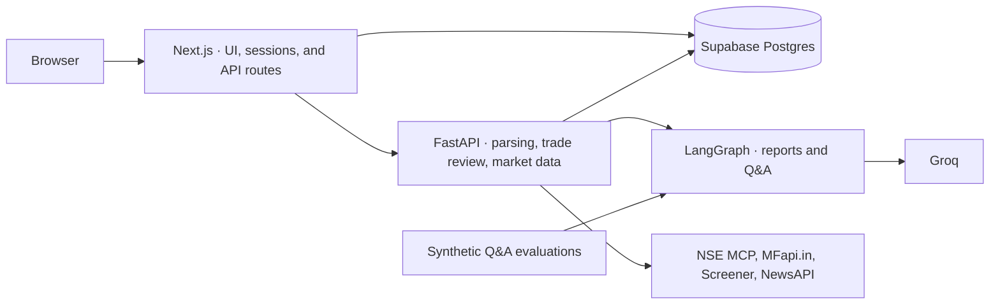

# Finance Agent

Finance Agent is a portfolio tracker and research app for Indian equities and mutual funds. Import broker statements, record trades, track holdings and profit and loss, and use the same portfolio facts in the dashboard, advisory reports, and Q&A.

## Features

- **Portfolio and trades** — Preview and confirm PDF, CSV, XLSX, or XLS broker statements. Spreadsheets with recognized holdings columns parse locally. Review unrecognized rows, track trades, and see invested cost, quoted market value, and realized and unrealized P&L.
- **Reports and Q&A** — Stream portfolio risk reports and save them to your account. Ask about your holdings, general finance, or a current or historical stock quote. Q&A cites the evidence it used and flags missing information.
- **Stocks** — Browse NSE market movers, search for symbols, and view timestamped quotes, daily charts, and stock fundamentals.
- **Mutual funds** — Compare schemes by equity category. MFapi.in supplies each scheme’s latest available NAV and NAV date. CAGR, risk ratios, P/E, and expense ratio display as unavailable.

## Architecture



Next.js derives the user ID from the authenticated session and owns account data, holdings, trade writes, and saved reports. FastAPI validates its internal service key and uses Postgres for the provider cache. Models handle extraction, ambiguous questions, and explanations. Application code computes portfolio arithmetic and enforces trade constraints.

| Path | Contents |
| --- | --- |
| [frontend/](frontend/) | Next.js UI, authenticated routes, and portfolio accounting |
| [ai-service/src/](ai-service/src/) | FastAPI, market-data adapters, and LangGraph workflows |
| [ai-service/migrations/](ai-service/migrations/) | Postgres schema migrations |
| [ai-service/evals/](ai-service/evals/) | Versioned synthetic Q&A cases and Ragas thresholds |
| [AGENTS.md](AGENTS.md) | Architecture migration plan and phase verification history |

## Run locally

These commands use Windows PowerShell. Use Node.js 22 or newer, Python 3.11 or newer, and a Supabase Postgres project or a local Postgres instance for development.

### 1. Install dependencies

From the repository root:

```powershell
py -m venv .venv
.\.venv\Scripts\python.exe -m pip install -r ai-service/requirements.txt
Set-Location frontend
npm ci
```

### 2. Prepare Postgres

Apply [001_init.sql](ai-service/migrations/001_init.sql), then [002_statement_imports.sql](ai-service/migrations/002_statement_imports.sql), using the database owner. Use the Supabase SQL Editor or run the files with `psql` and `ON_ERROR_STOP=1`. Keep the `finance_agent` schema private. Both services connect to the same database.

For hosted Supabase over IPv4, use the Session pooler. Download the project CA and use `sslmode=verify-full` with `sslrootcert` set to the URL-encoded absolute certificate path in both database URLs. [Supabase connection guide](https://supabase.com/docs/guides/database/connecting-to-postgres) · [Supabase TLS settings](https://supabase.com/docs/guides/platform/ssl-enforcement)

### 3. Configure the services

Create `frontend/.env.local`.

```dotenv
SUPABASE_DB_URL=<Postgres connection string>
FASTAPI_URL=http://127.0.0.1:8000
INTERNAL_API_KEY=<shared random secret>
SESSION_PASSWORD=<random 64-character hexadecimal secret>
```

Create `ai-service/.env`.

```dotenv
SUPABASE_DB_URL=<same Postgres connection string>
INTERNAL_API_KEY=<same shared secret>
GROQ_API_KEY=<Groq API key>
NSE_MARKET_DATA=true
```

Run the following command twice to generate independent values for `INTERNAL_API_KEY` and `SESSION_PASSWORD`. Keep these values and the database connection string out of version control. Rotating `SESSION_PASSWORD` invalidates existing sessions. Serve deployed frontend traffic over HTTPS so browsers can send the secure session cookie.

```powershell
node -e "console.log(require('node:crypto').randomBytes(32).toString('hex'))"
```

| Setting | Purpose |
| --- | --- |
| `GROQ_API_KEY` | Extraction for PDFs and other statement layouts, and model-powered Q&A and report explanations |
| `NSE_MARKET_DATA` | Enables both NSE MCP feeds. A fresh checkout defaults to disabled. |
| `NSE_QUOTE_MAX_AGE_SECONDS` | Quote freshness threshold. Defaults to 360 seconds. |
| `NSE_MCP_TIMEOUT_SECONDS` | Per-call NSE MCP timeout. Defaults to 15 seconds. |
| `NEWSAPI_KEY` | Enables the optional NewsAPI source for market context. |
| `MFAPI_BASE_URL` | Defaults to `https://api.mfapi.in`. MFapi.in requires no API key. |

### 4. Start the app

Open two terminals at the repository root. Start FastAPI in the first.

```powershell
Set-Location ai-service
..\.venv\Scripts\python.exe -m uvicorn src.api.main:app --loop asyncio:SelectorEventLoop --host 127.0.0.1 --port 8000
```

Start Next.js in the second.

```powershell
Set-Location frontend
npm run dev
```

Open **http://localhost:3000** and sign in or register. The FastAPI health check is at **http://127.0.0.1:8000/health**. FastAPI’s OpenAPI documentation and private endpoints require the internal service key.

## Data and accounting

| Data | Source and behavior |
| --- | --- |
| Current quotes and market movers | **NSE CM Market Live**. The app shows the exchange’s trade timestamp and labels older quotes as last published or delayed as applicable. |
| Daily charts, symbol lookup, and exact-date closes | **NSE Bhavcopy**. An exact-date Q&A lookup requires a trading session. Charts show raw closes and include a split- and bonus-adjusted return when corporate action data is available. |
| Fund categories and NAVs | **MFapi.in**. Each listed scheme is checked against the provider’s category and displays its own latest NAV date. |
| Stock fundamentals and news | **Screener** for stock fundamentals and **NewsAPI** for optional market news. |

The public NSE feeds are enabled here for an informational, non-commercial portfolio demo. A commercial deployment needs an appropriately licensed provider. [NSE MCP terms](https://www.nseindia.in/nse-mcp) · [NSE market data subscriptions](https://www.nseindia.com/static/nse-data-and-analytics/data-information-vending)

- The latest confirmed statement by coverage date supplies the starting inventory. Manual trades strictly after that date are replayed in trade-date and entry order. Older snapshots without coverage dates retain their entry-timestamp cutoff. Reconfirming the same file reuses the first successful import. PDF files need a readable text layer.
- Weighted-average acquisition cost governs partial sales and realized P&L. A reopened position starts a new cost basis. The write endpoint rejects sales that exceed available holdings. Fees and tax-lot accounting are outside the calculation.
- Statement quotes retain their source and as-of date. If an active holding lacks a quote, aggregate quoted market value and unrealized P&L are unavailable. Reports show dated public quotes separately from statement accounting.
- Dashboard and report risk share the same invested-cost concentration rules. A single holding is medium risk from 25% and high from 40%. A known sector is medium from 45% and high from 60%.
- Reports show the two largest cost weights together and the percentage of invested cost with a known sector. They flag matching realized-trade rows for review and preserve the recorded totals. Groq can explain the concentration flags using anonymous risk types. The same follow-up checks are available when the model is offline.
- Public report context includes an exchange-timestamped NIFTY 50 snapshot from NSE CM Market Live. Optional headlines come from Google News RSS or NewsAPI, cover the last 30 days, and favor coverage across the largest stock positions. Each displayed story has a publisher, publication date, and link.
- Q&A can return the latest available quote or one trading date’s close using `YYYY-MM-DD`. Use the Stocks detail page for the daily chart. Multi-session history, moving averages, and corporate-action lists are unavailable in chat.

## Testing and migration status

Run the frontend unit tests from the repository root.

```powershell
node --test frontend/tests/api.test.mjs frontend/tests/portfolio.test.mjs
```

Run the backend tests and deterministic Q&A fixtures.

```powershell
.\.venv\Scripts\python.exe -m pip install -r ai-service/requirements-dev.txt
Set-Location ai-service
..\.venv\Scripts\python.exe -m unittest discover -s tests -v
..\.venv\Scripts\python.exe -m evals.run
```

Set `SUPABASE_TEST_DB_URL` to a **disposable, migrated Postgres database** to include the backend restart and cache persistence test. The production frontend smoke test uses the same variable and a stub FastAPI upstream. Build Next.js first, then run the smoke test from the repository root.

```powershell
Push-Location frontend
npm run build
Pop-Location
node frontend/tests/smoke.mjs --production
```

The [Q&A evaluations workflow](.github/workflows/qa-evals.yml) runs deterministic checks without provider credentials. To run the model-judged suite locally, install [requirements-eval.txt](ai-service/requirements-eval.txt), export `GROQ_API_KEY`, `EVAL_API_KEY`, and `EVAL_MODEL`, and set `EVAL_BASE_URL` if your evaluator uses an OpenAI-compatible endpoint. Run from `ai-service/`.

```powershell
..\.venv\Scripts\python.exe -m evals.run --live-answer --judge --thresholds evals/thresholds-v1.json --output ragas-report.json
```

The Ragas run gates faithfulness, context precision, and context recall, and reports factual correctness. `--case CASE_ID` retries one case and `--judge-timeout SECONDS` adjusts its scoring deadline.

| Phase | Status |
| --- | --- |
| 1–4 · API boundary, Postgres, accounting, and LangGraph | Implemented and verified. |
| 5 · Q&A evaluations | All 12 deterministic cases pass. A complete live Ragas run remains pending after judge timeouts and rate limiting. |
| 6 · Market data cutover | Both NSE adapters returned INFY data for 20 November 2026. MFapi.in returned dated NAVs for all 12 fund categories. The production frontend build and API smoke test, all 27 backend tests, and all eight frontend unit tests passed. |

## Migrate an existing SQLite database

1. Pause legacy writes. Create a consistent SQLite backup with SQLite’s backup facility and retain the legacy checkout and configuration for rollback.
2. Dry-run the import from the repository root. This validates the backup without opening a Postgres connection.

   ```powershell
   .\.venv\Scripts\python.exe ai-service/scripts/import_sqlite.py --source ".\backup.db"
   ```

3. Confirm `SUPABASE_DB_URL` targets the intended migrated database. Rehearse on staging with synthetic data or an authorized backup. Execute and verify the import.

   ```powershell
   .\.venv\Scripts\python.exe ai-service/scripts/import_sqlite.py --source ".\backup.db" --execute
   .\.venv\Scripts\python.exe ai-service/scripts/import_sqlite.py --source ".\backup.db" --verify
   ```

4. Verify an imported sign-in, representative snapshots and reports, and persistence after restarting the services. The importer preserves IDs, password hashes, ownership, timestamps, and report JSON. Matching reimports are safe and conflicting rows roll back the transaction.
5. Before reopening writes, rollback consists of restoring the legacy deployment with the preserved SQLite backup. If Postgres has accepted writes, pause and reconcile them before rolling back.
